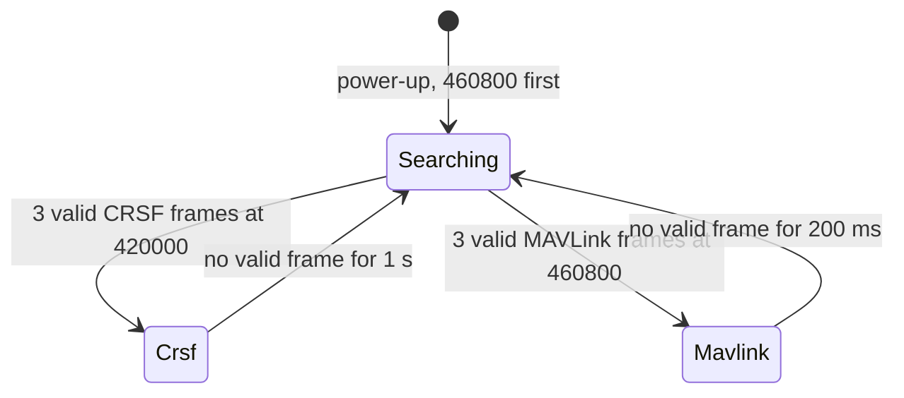

# rc-port

The UART of an ExpressLRS receiver on the MARV V2 flight controller. When the transmitter changes model, the receiver changes by
itself between CRSF at 420000 baud and MAVLink 2 at 460800 baud; this crate follows it, at the baud and in the protocol the receiver
is using, and **reports** what arrives. It **decides nothing**: no loss flag, no failsafe, no "safe values", no choice of stick
source, no arming rule, no write to the receiver's settings. The driver reports, the firmware decides.

`RcPort` is a sans-IO core over a [`crsf-codec`](https://github.com/Lmx154/crsf-codec) `Deframer` and a
[`mavlink-device`](https://github.com/Lmx154/mavlink-device) `Node`: bytes, UART errors and a time in; actions (writes, baud changes)
and reports out. `RcPort::run` drives it on a UART with `embedded-io-async` 0.7 and `embedded-hal-async` 1.0. `no_std`,
`forbid(unsafe_code)`, no allocation, no `static`, no spinning.



## Quick start

The sans-IO loop (compiled by `cargo test`). The async loop with embassy-rp is in [integration](docs/integration.md).

```rust
use rc_port::mavlink_device::{self, Outgoing, ParamError, ParamName, ParamStore, ParamValue, Telemetry};
use rc_port::{Action, Config, Hooks, Mode, RcPort, Report, MAVLINK_BAUD};

struct NoParams;
impl ParamStore for NoParams {
    fn count(&self) -> u16 { 0 }
    fn name(&self, _: u16) -> Option<ParamName> { None }
    fn get(&self, _: u16) -> Option<ParamValue> { None }
    fn find(&self, _: &ParamName) -> Option<u16> { None }
    fn set(&mut self, _: u16, _: ParamValue) -> Result<ParamValue, ParamError> { Err(ParamError::NotFound) }
}
struct NoTelemetry;
impl Telemetry for NoTelemetry {
    fn sample(&mut self, _: u32, _: u64, _: &mut Outgoing<'_>) -> bool { false }
}
struct Firmware { sticks: Option<[u16; 16]> }
impl Hooks for Firmware {
    fn report(&mut self, report: Report) {
        if let Report::Sticks(s) = report { self.sticks = Some(s.channels_us); }
    }
}

let mut slots = [];
let mut port = RcPort::new(Config::new(), mavlink_device::Config::new(1, 1), &mut slots)
    .expect("at most 16 accept list entries");
let (mut params, mut tel, mut fw) = (NoParams, NoTelemetry, Firmware { sticks: None });
// After power-up the port sets the UART to 460800 baud: flush, wait for the transmitter, set.
let mut bauds = Vec::new();
while let Some(action) = port.poll_action(0, &params, &mut tel, &mut fw) {
    match action {
        Action::Write(bytes) => { let n = bytes.len(); /* uart.write(bytes) took n */ port.written(n) }
        Action::Flush | Action::WaitTxIdle => port.done(0),
        Action::SetBaud(baud) => { bauds.push(baud); /* uart.set_baud(baud) */ port.done(0) }
    }
}
assert_eq!(bauds, [MAVLINK_BAUD]);
// Then, on each wake: bytes read go to `receive`, read errors to `uart_error`, then the actions
// until None, then sleep until `next_deadline_us()` or the next bytes.
port.receive(&[0x00, 0x55], 1_000, &mut params, &mut fw);
assert_eq!(port.stats().mode, Mode::Searching);
assert_eq!(port.next_deadline_us(), 50_000); // the end of the 460800 listening period
assert_eq!(fw.sticks, None);
```

## Docs

| Page | In one line |
|---|---|
| [states](docs/states.md) | Searching, Crsf, Mavlink; the constants; the lock-time bound |
| [reports](docs/reports.md) | `StickReport`, link reports, timestamps, the counters in `Stats` |
| [integration](docs/integration.md) | The async loop, writes and baud changes, what the application must do, known receiver behaviour |
| [testing](docs/testing.md) | The model, host tests, what is not covered |
| [hil-logs](docs/hil-logs.md) | How to read the bench programs' output |
| [hil/](hil/README.md) | The on-board bench programs: wiring and how to run them |

```text
src/  lib.rs  config.rs (constants, Config)  port.rs (RcPort, Action, Hooks, Stats, Mode)  report.rs  run.rs (RcPort::run, SetBaud, TxBusy)
      embassy.rs (feature embassy-rp-0-10)  sim.rs, tests.rs, run_tests.rs (host tests)
hil/  on-board programs, own workspace      tools/run.sh  build, flash and run one hil program under the probe lock
```

## Used by

[MARV-FC](https://github.com/Lmx154/MARV-FC) (receiver input). Dependencies `crsf-codec` and `mavlink-device`
are git dependencies pinned to a commit, so an application that pins the same commits gets one copy of each; `marv-dialect` is
pinned to the commit `mavlink-device` uses. Work on a sibling locally with a `[patch]` entry (shown in `Cargo.toml`).

## Status

- Version 0.1.0, `publish = false`; the API may still change.
- Host tests on a UART model (31 tests plus the example), including proptests of the report invariants and the lock-time bound.
- Runs on the MARV V2 Rev 1 board behind an ExpressLRS receiver: follows CRSF and MAVLink changes, sends CRSF battery telemetry, and carries the project's own `MARV_TEST` message through the radio.
- Not observed: stick reports in MAVLink mode through the port, other receivers or ExpressLRS versions, flight. See "Known receiver behaviour" in [integration](docs/integration.md).

## MARV project

| Repository | Role |
|---|---|
| [MARV-FC](https://github.com/Lmx154/MARV-FC) | Flight-controller firmware for the MARV V2 board (RP2350B) |
| [MARV-GCS](https://github.com/Lmx154/MARV-GCS) | Ground station (`marv-gcs`) and command line (`marv-cli`) |
| [MARV-sim](https://github.com/Lmx154/MARV-sim) | Simulator that runs the firmware's flight code |
| Sensors | [icm45686](https://github.com/Lmx154/icm45686-rs) · [lsm6dsk320x](https://github.com/Lmx154/lsm6dsk320x-rs) · [bmp581](https://github.com/Lmx154/bmp581-rs) · [bmm350](https://github.com/Lmx154/bmm350-rs) · [sam-m10q](https://github.com/Lmx154/sam-m10q) · [adc-battery](https://github.com/Lmx154/adc-battery) |
| Board I/O | [pio-sdmmc](https://github.com/Lmx154/pio-sdmmc-rs) · [qmi-psram](https://github.com/Lmx154/qmi-psram-rs) · [ws2812c](https://github.com/Lmx154/ws2812c-rs) · [usb-cdc](https://github.com/Lmx154/usb-cdc) · [pio-uart](https://github.com/Lmx154/pio-uart) |
| Motors and links | [dshot](https://github.com/Lmx154/dshot-rs) · [esc-passthrough](https://github.com/Lmx154/esc-passthrough) · **rc-port** · [crsf-codec](https://github.com/Lmx154/crsf-codec) · [mavlink-device](https://github.com/Lmx154/mavlink-device) · [marv-dialect](https://github.com/Lmx154/marv-dialect) |
| Other drivers | [lc76g](https://github.com/Lmx154/lc76g-rs) (Quectel LC76G GNSS) |

## Licence

MIT, see `LICENSE`.
