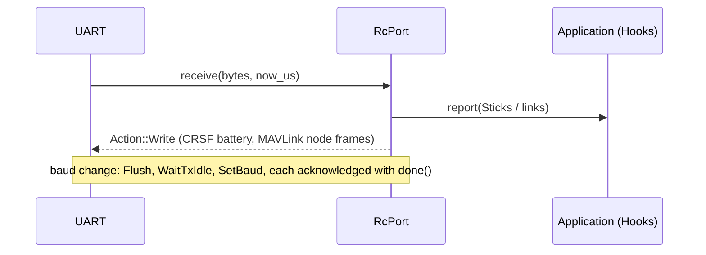

# Integration

Part of [rc-port](../README.md)

How an application drives the port: the async `run` loop, what is written and when, how the baud is changed, and what the
application must provide and decide. The sans-IO loop is in the README.



## Works with

- Any MCU and HAL whose UART implements `embedded_io_async::{Read, Write}` (reader cancel-safe, returning `Pending` when it has
  nothing), plus this crate's `SetBaud` and `TxBusy`, and a `DelayNs`. Any executor; no embassy crate in the core.
- embassy-rp 0.10 on RP2350, the unsplit `embassy_rp::uart::BufferedUart`, with the feature `embassy-rp-0-10` (implements `SetBaud`,
  `TxBusy` and `From<embassy_rp::uart::Error>` for `UartError`; the chip feature, for example `embassy-rp/rp235xb`, comes from the
  application).
- The sans-IO core on its own, with any I/O.

## The async loop

```rust,ignore
// embassy-rp 0.10, feature `embassy-rp-0-10`; UART0, GPIO14 TX, GPIO17 RX.
let mut uart = BufferedUart::new(p.UART0, p.PIN_14, p.PIN_17, Irqs, tx_buf, rx_buf, uart_config);
let mut port = RcPort::new(rc_port::Config::new(), mavlink_device::Config::new(1, 1), &mut slots)?;
let end = port.run(&mut uart, &mut Delay, || Instant::now().as_micros(), &mut params, &mut telemetry, &mut hooks).await;
// RunError::Write(_) | WriteZero | EndOfStream: call run again; the port kept its state.
```

`run` carries out every action (a write with `write`, acknowledged byte-exactly; a baud change as `flush`, then `tx_busy` checked
every 20 us through the delay until false, then `set_baud`), then waits for the first of bytes and `next_deadline_us` (at most
100 ms). A read error becomes a counted `UartError` and `run` reads again at once (unlike `Node::run`, which returns). It returns
only on a write or flush error, a write of 0 bytes or a read of 0 bytes.

The reader must return `Pending` when it has nothing: `run` sleeps only by waiting on the read and the timer together, so an
always-ready reader makes it spin. The UART's error type must convert into `UartError`. Dropping the `run` future at any await
loses nothing. While `run` is awaited the port cannot be touched: everything goes through `Hooks`, `ParamStore` and `Telemetry`,
which are called from the port's task and must not block.

## Writes and baud changes

| Topic | Rule |
|---|---|
| When | Only while locked, only in the locked protocol. Nothing is written while searching. When a lock is left, the unsent rest of a frame is dropped |
| CRSF | `Hooks::crsf_frame` is asked for one whole frame at most once per `crsf_tx_interval_us`, the first time at the first poll after the lock; the application writes it (for example `crsf_codec::encode_battery`) |
| MAVLink | The node's `poll_transmit` frames (heartbeat, streams, replies) |
| Baud change | Always `Flush`, `WaitTxIdle`, `SetBaud(baud)`, each acknowledged with `RcPort::done`, nothing written in between. After `SetBaud` both decoders are cleared: `Deframer::clear` (the bytes held are counted in `garbage_bytes`) and `Node::on_link_down` (streams to defaults, replies and lists dropped, ground station no longer present, slowdown 0; its receive buffer is dropped uncounted). Bytes already in the UART's receive buffer from the old baud are fed to the new decoder as garbage; the lock threshold keeps them harmless. Bytes received during a change are counted as garbage |
| Time | Each call with `now_us` first applies the deadline due at that time, then its input. `now_us` must be non-decreasing and, for `run`, on the clock of the delay |

## The node and the accept list

`RcPort::new(config, mavlink_config, streams)` builds the node and returns a `Result`. Its accept list is the application's
(`mavlink_config.accept`, in its order) followed by RC_CHANNELS_OVERRIDE (70) and RADIO_STATUS (109) where the application does not
list them; where it does, the entry keeps its place with the port's CRC_EXTRA for that id. At most 16 entries
(`mavlink_device::MAX_ACCEPT`): a longer merged list is `Err(NewError::AcceptListFull)`.

The application's other listed messages go to `Hooks::mavlink` (default: nothing), only while locked on MAVLink and from the 3rd
valid frame of the lock on, once per frame, like stick reports; before the lock they are counted in `lock_discarded`. Each is a
valid MAVLink frame for the lock and for leaving it.

| While listening at 460800 | Behaviour |
|---|---|
| HEARTBEAT, parameter, command frames | The node acts as `mavlink-device` always does, but writes only once locked |
| Parameters | No parameter is written before the lock: the node sees a view of the `ParamStore` that reads as it is and refuses `set` with `ParamError::Rejected`, so a PARAM_SET heard while listening (wrong-baud garbage included) changes nothing. The answer is queued with the value unchanged and written only if the port locks on MAVLink before the next baud change drops it. Once locked, PARAM_SET calls `ParamStore::set` as usual |
| Commands | A COMMAND_LONG the node does not serve itself waits in its reply queue and `Telemetry::command` runs only when `poll_action` asks the node for a frame, that is, only while locked on MAVLink. So a command heard while listening runs once and its COMMAND_ACK is written if the port locks on MAVLink before the next baud change; otherwise it never runs and no ACK is sent |

## What the application must do

- Provide the clock (`now_us`, microseconds), the executor and the task that awaits `run`, the `[StreamSlot]` slice, the
  `ParamStore` and `Telemetry` of `mavlink-device`, and the `Hooks` (reports, CRSF telemetry frames, counters).
- Make its own loss and failsafe choices from the timestamps and counters (ages are `now - last_sticks_us` and so on). For
  reference only: Betaflight reports RXLOSS after 150 ms without a frame and enters failsafe stage 2 after 1.5 s; ArduPilot's radio
  failsafe fires after `RC_FS_TIMEOUT` (default 1.0 s), and overrides expire after `RC_OVERRIDE_TIME` (default 3.0 s). Neither
  uses link quality for failsafe.
- Set a pull-up on the UART's RX pad after the UART is built: embassy-rp 0.10 leaves the pad with no pull
  (`pac::PADS_BANK0.gpio(17).modify(|w| w.set_pue(true))`).
- Choose which stick source is in charge, which MAVLink senders to accept, and whether a change of protocol is allowed while armed.
  The driver always follows; while armed a change simply looks like a gap in stick reports.

## Known receiver behaviour

- ExpressLRS 4.0.1 sends RC_CHANNELS_OVERRIDE in MAVLink mode only until it has output CRSF once in the same power-up; after that it
  sends none until it is power-cycled (a radio off and on does not bring them back). RADIO_STATUS is not affected. The crate reports
  whatever arrives: in that state it locks on MAVLink (RADIO_STATUS keeps it there), reports RADIO_STATUS and no sticks.
- Leaving Crsf happens exactly `T_LEAVE_CRSF` (1 s) after the last valid CRSF frame. Link-statistics frames are valid frames, so with
  the radio off the lock holds while the receiver keeps sending them.
- A lock needs 3 valid frames in one listening period; frames 1 and 2 are discarded (`lock_discarded`). When only link statistics
  (10 per second) return after a loss, the default 200 ms CRSF listening period holds too few frames to lock until stick frames resume.
- With the radio off in MAVLink mode the mode stays Mavlink (RADIO_STATUS continues with `rssi` 0) and no baud change happens.
- The ground station's MAVLink traffic reaches the port through the radio only with TX backpack firmware 1.5.0 or newer.
- On the real line at the wrong baud, a listener decodes no frames of the other protocol.

## Code

`src/run.rs` (`RcPort::run`, `SetBaud`, `TxBusy`, `RunError`), `src/embassy.rs`, `src/port.rs`.

## Related

[states](states.md), [reports](reports.md), [testing](testing.md).
