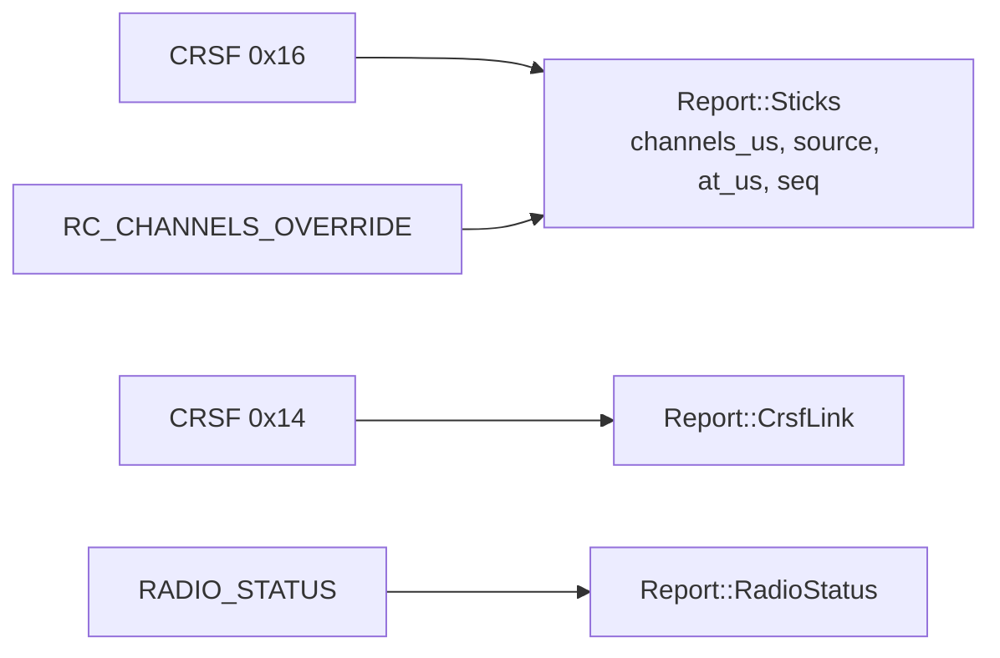

# Reports and counters

Part of [rc-port](../README.md)

One stick report type for both protocols, and two raw link reports that are never merged. Each comes through `Hooks::report`, once
per frame, from inside `RcPort::receive`.



## Types

```text
pub struct StickReport { pub channels_us: [u16; 16], pub source: Source, pub at_us: u64, pub seq: u32 }
pub enum Source { Crsf, Mavlink { system_id: u8, component_id: u8 } }
pub struct CrsfLinkReport { pub stats: crsf_codec::LinkStatistics, pub at_us: u64, pub seq: u32 }
pub struct RadioStatusReport { pub status: RadioStatus, pub system_id: u8, pub component_id: u8, pub at_us: u64, pub seq: u32 }
pub struct RadioStatus { pub rssi: u8, pub remrssi: u8, pub txbuf: u8, pub noise: u8, pub remnoise: u8, pub rxerrors: u16, pub fixed: u16 }
pub enum Report { Sticks(StickReport), CrsfLink(CrsfLinkReport), RadioStatus(RadioStatusReport) } // non_exhaustive
```

## Values

| Source | `channels_us` |
|---|---|
| CRSF | `crsf_codec::raw_to_us` of each of the 16 raw values (172 gives 988, 992 gives 1500, 1811 gives 2012, not clamped). In switch modes that do not send 16 channels, channels 15 and 16 carry link quality and RSSI and are passed as received |
| MAVLink | `chan1_raw` to `chan16_raw` of RC_CHANNELS_OVERRIDE exactly as received, 0 and 65535 ("ignore") included; channels 9 to 16 of a payload cut before them (MAVLink 2 drops trailing zeros) read 0; channels 17 and 18 are dropped |

MAVLink sticks are reported only when `target_system` is the node's system id or 0; another target is counted in
`Stats::overrides_not_for_us` (the frame still counts as a valid MAVLink frame). The sender is reported; which senders to accept is
the firmware's (ArduPilot accepts only its ground station's system id).

## Guarantees

- Every stick report comes from exactly one frame that passed its CRC while the port was locked, as the 3rd or a later frame of the
  lock: never a held, repeated, interpolated or default value. Across a change there is only a gap.
- `at_us` is the `now_us` of the `receive` call that delivered the frame: when the bytes were read, not when they arrived. After a
  stall, frames the UART buffered meanwhile are delivered with a fresh time. Keep the UART receive buffer small; it bounds how many
  such frames one stall can deliver. At 250 Hz CRSF (a 26-byte RC frame every 4 ms) a buffer of B bytes holds about B / 26 frames:
  64 bytes about 2 frames (8 ms), 256 bytes about 9 (36 ms), 1024 bytes about 39 (156 ms).
- `seq` counts the reports of that kind; the first is 1; it wraps.

## Counters

`RcPort::stats()`, or `Hooks::stats` while `run` is awaited. Counters and timestamps only.

| Field | Meaning |
|---|---|
| `mode`, `mode_since_us`, `mode_changes` | Current state, when it began, locks with a different protocol |
| `sticks`, `last_sticks_us` | Stick reports and the time of the last |
| `crsf_links`, `last_crsf_link_us` | CRSF link-statistics reports |
| `radio_status`, `last_radio_status_us` | RADIO_STATUS reports |
| `last_gcs_heartbeat_us`, `last_gcs_heartbeat_sender` | Receive time and `Some((system, component))` of the last ground-station HEARTBEAT; kept across baud changes. Any HEARTBEAT of type MAV_TYPE_GCS from any sender counts, so the application must compare the sender (for example with the station's (255, 190)) before trusting the time |
| `lock_discarded`, `overrides_not_for_us` | Lock-on frames not reported; overrides for another system |
| `crc_errors` | CRSF CRC plus MAVLink checksum, handled and listed messages |
| `garbage_bytes` | Both decoders, plus bytes received during a baud change, plus bytes the CRSF deframer held when a baud change ended |
| `uart_framing`, `uart_parity`, `uart_break`, `uart_overrun`, `uart_other` | UART errors one by one |
| `tx_busy_polls` | Checks of `TxBusy::tx_busy` that `run` made while waiting for the transmitter to go idle before a baud change and that found it busy (one per 20 us, saturating, always 0 with the sans-IO core alone). The wait has no timeout: a transmitter that never goes idle holds `run` there and shows as `tx_busy_polls` rising, because `run` calls `Hooks::stats` after each busy check |
| `stream_slowdown_ms` | Not a counter: the MAVLink node's stream slowdown in ms (`Node::stream_slowdown_ms`). Each RADIO_STATUS moves it by ArduPilot's steps (`txbuf` below 20: +60, below 50: +20, while under 2000; above 95: -40 while over 200; above 90: -20 down to 0); every baud change sets it to 0 (`Node::on_link_down`). `Hooks::stats` is called when it alone changed |

The node's own counters are in `port.node().stats()`.

## Code

`src/report.rs`, `src/port.rs` (`Stats`, `Hooks`).

## Related

[states](states.md), [integration](integration.md); CRSF decoding is in [crsf-codec](https://github.com/Lmx154/crsf-codec).
