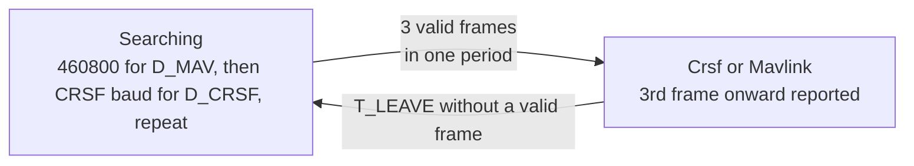

# States, constants and lock time

Part of [rc-port](../README.md)

The port is always in one of three states. It follows the receiver by listening at one baud at a time, locking after a few valid
frames, and leaving after a silence. Valid frames are counted per listening period; the count restarts at each baud change.



## Rules

| Rule | Detail |
|---|---|
| Search order | At power-up and after leaving CRSF the search starts at 460800; after leaving MAVLink it starts at the CRSF baud ("the other baud first") |
| Lock | `LOCK_FRAMES` valid frames in one listening period. Frames 1 and 2 are counted (`Stats::lock_discarded`) and not reported; the 3rd and every later one are |
| Leave | Crsf after `T_LEAVE_CRSF` without a valid CRSF frame; Mavlink after `T_LEAVE_MAV` without a valid MAVLink frame; then Searching |
| Valid CRSF frame | Any frame the deframer accepts (address 0xC8, length 2 to 62, CRC-8), of any type |
| Valid MAVLink frame | One the node hands over through `Node::receive_with`'s hook: RC_CHANNELS_OVERRIDE (70), RADIO_STATUS (109) or a message of the application's accept list; MAVLink 2, incompatibility flags 0, right checksum with CRC_EXTRA, sender not the node's own system id. HEARTBEAT, parameter and command frames do not count. RADIO_STATUS counts, so MAVLink mode holds with the radio link down |
| `Stats::mode_changes` | Counts locks whose protocol differs from the previous lock's (Crsf, Searching, Crsf counts 0; the first lock counts 0) |

## Constants

| Constant | Value | Source |
|---|---|---|
| `CRSF_BAUD` (`Config::crsf_baud`) | 420000 | ExpressLRS default; changeable when the receiver is flashed |
| `MAVLINK_BAUD` | 460800 | ExpressLRS, fixed |
| `LOCK_FRAMES` | 3 | ArduPilot `requires_3_frames` |
| `T_LEAVE_CRSF_US` | 1 000 000 | ArduPilot's 1000 ms dwell; a fade under 1 s never touches the baud |
| `T_LEAVE_MAV_US` (`Config::t_leave_mav_us`) | 200 000 | 20 RADIO_STATUS periods; must exceed any same-mode re-open gap |
| `D_MAV_US` (`Config::d_mav_us`) | 50 000 | at least 5 RADIO_STATUS periods |
| `D_CRSF_US` (`Config::d_crsf_us`) | 200 000 | at least 5 RC frame periods at the slowest RF rate |
| `CRSF_TX_INTERVAL_US` (`Config::crsf_tx_interval_us`) | 100 000 | no pacing rule is established; a conservative fixed minimum interval |

`Config` is `#[non_exhaustive]` (`Config::new().with_d_mav_us(..)`); a duration of 0 behaves as 1 us. The constants marked as
`Config` fields were set from bench observations.

## Lock time, proved on the model

For one change from protocol A to B, with `t_last` the end of the last A frame and `G` the gap to the start of the first B frame:

```text
lock - t_last <= max(T_LEAVE_A, G) + D_A + 5 P + 2 d + 2 eps + 3 w
```

`D_A` is the listening time at A's baud, `P` the longest interval between starts of consecutive valid B frames, `d` the longest B
frame, `eps` the longest baud change (flush, transmitter drain, 15 bit periods), `w` the time from a frame's end to the `receive`
call that hands it over. When B frames already flow as the A lock is left (`G <= T_LEAVE_A`): `lock - t_last <= T_LEAVE_A + eps + 3 P
+ d + 2 w`. With the defaults and MAVLink as B (P = 10 ms, d = 1.09 ms) this is `max(T_LEAVE_A, G) + 252.2 ms + 2 eps + 3 w`. On the
model (w = 1 ms, gap 100 ms) locks came 1020.5 ms after the last CRSF frame and 209.1 ms after the last MAVLink frame.

Re-lock after a total loss in CRSF mode, frames returning at `t_r` while searching: `relock - t_r <= D_MAV + 5 P + 2 d + 2 eps + 2 w`
(the argument is at the top of `src/tests.rs`). Frames returning near the end of a CRSF listening period start a lock-on that the
next baud change cuts, so the lock then waits for one 460800 period and two baud changes. On the model at 250 Hz the worst re-lock
was 64.7 ms (bound 73.3 ms), at 50 Hz 110.7 ms (bound 153.3 ms).

These are host results on the model, not board results.

## Code

`src/config.rs`, `src/port.rs`.

## Related

[reports](reports.md) for what a lock produces; [integration](integration.md) for the baud-change sequence; [testing](testing.md).
