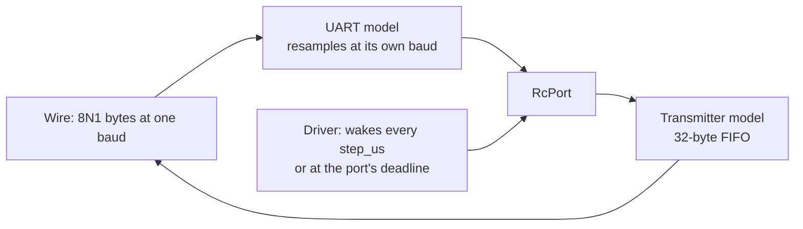

# Testing

Part of [rc-port](../README.md)

`cargo test` runs 31 host tests (28 in `src/`, 3 in `tests/commands.rs`) and the README example. They run against a model of the
wire and a UART in `src/sim.rs` (test-only).



The model gives the bytes, framing errors and breaks a real UART would at a wrong baud, a transmitter with a 32-byte FIFO that
drains at the baud rate, and a made-up clock. Assumptions are listed at the top of the file: exact edge detection (a PL011 has 1/16
bit of jitter), no clock error, no noise, no overrun, a baud change abandons the character in progress and keeps the receive buffer,
the receiver is off for 15 bit periods.

## Core tests

| Test | Checks |
|---|---|
| `uart_model_same_baud_is_exact_wrong_baud_is_garbage` | The model's control: exact bytes at the sender's baud, garbage with framing errors and no valid frame at the other |
| `i13_every_stick_report_is_one_valid_frame_of_the_input` (proptest) | Random valid streams of both protocols with mode changes, unique stick values, 0, 65535 and cut payloads, overrides for other systems, garbage and corrupted frames: every report equals exactly one valid frame of the input, in order, never twice, after the frame ended |
| `i14_*` | CRSF frames stop: reports stop and counters freeze; MAVLink overrides stop: RADIO_STATUS continues and the mode stays |
| `i16_no_report_from_valid_frames_*` (proptest, wrong-baud garbage) | CRSF sent at 420000 received at 460800 and MAVLink sent at 460800 received at 420000, with valid frames of either protocol inserted: no report, no lock. `i16_negative_control_fails_with_lock_frames_1` runs the same check with `LOCK_FRAMES` = 1 and fails |
| `i17_nothing_written_while_searching_tx_idle_before_every_baud_change` (proptest) | Every write is in a locked mode at its protocol's baud and parses as whole frames (CRSF at least `crsf_tx_interval_us` apart); every baud change follows a Flush and a WaitTxIdle with no write between |
| `i18_same_mode_gap_shorter_than_t_leave_changes_nothing` (proptest) | Gaps up to `T_LEAVE` less 30 ms, silent or with garbage at either baud |
| `mode_following_10_changes_each_way`, `lock_bound_holds_for_random_gaps_and_phases` | 10 changes each way in one run: mode-change counter 20, every lock within both bounds, every report the expected value; random gaps of 0 to 1.5 s at 250 or 50 Hz under `max(T_LEAVE_old, gap) + 280 ms` |
| `crsf_link_lost_keeps_searching_writes_nothing_relocks_within_bound` | Leave at exactly 1000 ms, alternate 460800 for 50 ms and CRSF for 200 ms, nothing written, re-lock within the bound for return times swept 2 ms apart |
| `mavlink_link_lost_stays_mavlink_sticks_frozen_radio_status_advances` | 5 s of RADIO_STATUS only |
| `chunking_does_not_change_reports_counters_or_actions` (proptest) | Whole runs, random pieces and single bytes give the same reports, counters and trace |
| `late_receive_applies_the_deadline_before_the_bytes`, `unsent_rest_of_a_frame_dropped_when_the_lock_is_left` | Deadline ordering and the dropped rest of a frame, both protocols |
| `listed_mavlink_message_*`, `merged_accept_list_over_16_is_an_error`, `application_listing_rc_channels_override_changes_nothing` | An application message handed over once per frame from the 3rd frame of a MAVLink lock, never before, never in CRSF mode, never from wrong-baud garbage; a wrong CRC_EXTRA for 70 loses to the port's |
| `param_set_applied_only_once_locked_on_mavlink` | A PARAM_SET between the two lock-on frames changes nothing; after the lock it is applied |
| `tests/commands.rs` | A COMMAND_LONG heard while searching runs exactly once when the port locks on MAVLink and its ACK is written; heard in a period that ends without a lock, it never runs and no ACK is written |
| `override_target_filter_and_exact_values`, `uart_error_burst_counted_no_report_no_mode_change_before_t_leave` | Target filter, exact values, error counting |

## Async front end

Against a fake UART on the same model and a fake delay, polled by hand: `run_follows_crsf_to_mavlink_and_back`,
`run_flushes_then_waits_tx_idle_then_sets_baud`, `run_dropped_at_any_await_loses_nothing` (dropped after every 1 to 5 polls, over
10 000 times, same reports and counters as an undisturbed run), `run_future_is_send` (compile-only),
`run_counts_idle_wait_polls_that_found_the_transmitter_busy`, `stats_carry_the_node_stream_slowdown_to_the_hook`.

## Lints and builds

```text
cargo clippy --all-targets -- -D warnings
cargo clippy --lib --target thumbv8m.main-none-eabihf --features embassy-rp-0-10,embassy-rp/rp235xb -- -D warnings   # back-end; same with cargo build
```

`--all-features` on the host cannot build embassy-rp, which needs a chip feature and the ARM target.

## Not covered

- Anything on a board or with a receiver beyond the bench programs in [hil](../hil/README.md). No cancel on the real HAL.
- The lock-time bound uses the model's frame periods (CRSF at 250 and 50 Hz, RADIO_STATUS every 10 ms, overrides every 20 ms), not
  the receiver's measured ones.
- While locked, the CRC is the only defence: wrong-baud garbage that happens to form a valid frame of the locked protocol (CRSF about
  2^-24 per byte position, an RC frame about 2^-32) would count and could be reported. Not seen in the tests.
- A dwell is not extended when a lock-on is in progress, which is why the re-lock bound has `5 P + 2 d + 2 eps + 2 w` after `D_MAV`.
- No test with a CRSF baud equal to 460800 (`Config::crsf_baud` can be set to it; the search then alternates at one rate).
- The simulated UART has no noise, baud error, the real receiver's oversampling, FIFO overruns or idle gaps inside a frame. On the
  real line at the wrong baud, the 420000 listener decoded 0 CRSF frames from MAVLink traffic and the 460800 listener accepted 0
  MAVLink frames from CRSF traffic over a few minutes with one receiver.
- No `defmt` feature. `TxBusy` waiting has no timeout; a transmitter that stays busy shows as `tx_busy_polls` rising.

## Code

`src/sim.rs`, `src/tests.rs`, `src/run_tests.rs`, `tests/commands.rs`.

## Related

[states](states.md), [integration](integration.md), [hil](../hil/README.md).
